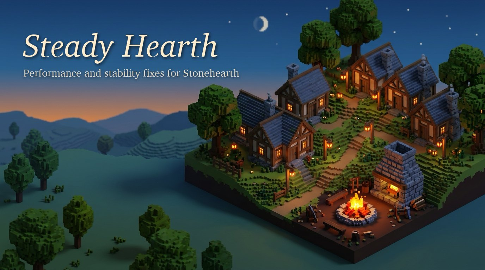

<p align="center">
  
</p>

<p align="center">
  <a href="https://github.com/Smaraputra/steady-hearth/releases/latest"></a>
  <a href="https://steamcommunity.com/sharedfiles/filedetails/?id=3830019326"></a>
  <a href="https://github.com/Smaraputra/steady-hearth/actions/workflows/ci.yml"></a>
  
  
  
  
  
  
</p>

# Steady Hearth

Performance and stability fixes for Stonehearth 1.1, in one small mod. It works on the base game and is compatible with the [ACE mod](https://github.com/StonehearthACE-team/stonehearth_ace), and includes fixes that improve performance when ACE is installed. Every change is measured, can be switched off, and adds nothing to your town's saved state.

> **Disclaimer.** Steady Hearth is an unofficial community mod. It is not affiliated with, endorsed by, or supported by Radiant Entertainment, Riot Games, or the Stonehearth ACE team. ACE is not required. Where this README mentions ACE, it describes compatibility and the fixes that apply to ACE's code, not a partnership. Use it at your own risk and keep a backup of your saves. Please report problems here, not to the game's or ACE's developers.

## What it fixes

The mod patches the game's Lua code at load time. Each patch first checks that the function it replaces comes from the expected source file and line range, and leaves the original alone otherwise, so an update that moves or replaces that code switches the patch off. The check cannot catch a change that keeps the same lines, so it lowers the risk from future updates without ruling it out.

| Fix | Applies to | What the original code does | Effect, measured in our 4-town test (112 hearthlings) |
| :--- | :--- | :--- | :--- |
| Restock search caches (R7, R7b) | ACE | Each restock errand creates a new native search cache that the engine keeps for the session, so restock searches slow down the longer a session runs | Restock searches stay fast all session: the median search took 0 to 11 game seconds instead of rising from 22 to 578 over one game day. Over two game days the simulation was busy **26.7% less** (one run pair), and construction got **about twice as far** per game day. The gain grows with session length and the number of restock errands |
| Building plan nav grids (E8) | ACE | Each building plan copies every finished building in the world, in every town, into its own navigation grid (twice). Cheap in a small town, it grows with every finished building in the world | Pauses of **10 to 25 s per plan** in our test drop to 8 s at most and usually under a second, with identical plans building by building. Summed over a whole test run with 36 finished buildings, about 13 minutes of pauses became seconds. In a one-town game with few buildings the pauses are much shorter to begin with, since the cost grows with every finished building in the world |
| Building plan freeze (E9) | ACE | The blank navigation grid a plan starts from is requested with uninitialized bounds. Usually harmless, but now and then the engine walks a huge area in one step | The multi-minute freeze that hit about one test run in ten did not occur in the validation runs (all 16 clones took 0 to 1 ms) |
| Search early exit (RT1, RT2) | Base game and ACE | Item searches keep running after their answer is known, and orphaned timers trip engine checks | Base game busy time **-2.3%** (p 0.009), job-list time **-8.0%** (p 0.004). Duplicate AI decisions went from 5,000 to 12,000 per game day to none |
| Lease release fan-out | Base game and ACE | Every running path search listens to every item lease released in the town | Lua time in path-search code **7.2% to 1.5%** of all Lua samples. Grows with the number of hearthlings searching at once |
| Harvest need ratings | Base game and ACE | Harvest actions rate each candidate tree or bush against every combination of its material tags | Share of Lua time in this code **10.1% to 0.3%** with ACE, identical results checked call by call |
| Material checks | Base game and ACE | Searches compare every candidate item's material tags with the requested material, rebuilding the same comparison each time | Share of Lua time in material checks **4.1% to 2.8%** (base game) and **7.3% to 5.1%** (ACE), same answers ([experiment 009](docs/experiments/009-restock-caches-material-memo.md)) |
| Stale placement requests (E1, A2b) | Base game and ACE | A placement request stays in the town's table after the item is placed, so workers keep checking it (up to 5 s each) | Stale requests after two game days **64 to 0** across the 4 towns |
| Script errors (RT6, X7) | Base game / ACE | A building-monitor error, and an ACE titles error in multiplayer towns | Errors gone |

Measured on the project's benchmark: an XL scenario with 4 player towns of 28 hearthlings each, at game speed 2, under Wine on an Apple M4 Pro. The benchmark is a stress test: 112 hearthlings and 44 buildings (8 of them under construction) in one world. Effects that grow with world size or session length are smaller in a typical one-town game, and each row says what its effect grows with. The numbers compare runs with and without each fix on the same machine, and your own frame rates will differ. Method, raw numbers and caveats for every row are in [`docs/experiments/`](docs/experiments/). Most rows were measured on the flat map of scenario v3, the material checks row on xl-v4. Scenario xl-v4 (2026-10-29) adds two ridges with stepped passes, a lake beside every town and scattered wild trees, and its first profiles are in [`docs/atlas/profiles-2026-10-28.md`](docs/atlas/profiles-2026-10-28.md).

## Faster loading, smaller saves, better autosave

Version 1.3.0 targets the time between clicking Load and playing, and what a save carries.

| Change | Applies to | What the original code does | Effect, measured in our 4-town test (112 hearthlings, saves of 69 MB with ACE and 54 MB without) |
| :--- | :--- | :--- | :--- |
| Loading screen wait | Base game and ACE | After a save has loaded, the loading screen keeps the game hidden for another 0.7 s per second of loading, up to 35 s | Up to 32 s less waiting after every save load, on any machine: a 20-second load saves about 11 s, a load of 50 s or more saves about 32 s. In our test, load to playable went from **109.7 s to 74.3 s** with ACE (together with the catalog change below) and **38.1 s to 32.1 s** without ([experiment 011](docs/experiments/011-loading-warmup-cap.md)) |
| Catalog material tags | ACE | At every launch and save load the catalog lists every combination of every item's material tags (586,883 with ACE) and builds and hashes each one from scratch | About **4 s less** at every launch and save load with ACE (3.7 to 4.0 s on an Apple M4 Pro under Wine), identical results. Depends on the installed mods, not on the size of your town ([experiment 010](docs/experiments/010-material-subsets-incremental.md)) |
| Inventory restore | Base game and ACE | When a save loads, every stored item is checked against every resource material (105 with ACE), though the answer depends only on the item type | With ACE the restore step of our test save took **12.9 s, now 11.6 s** (one run pair), no measurable change without ACE. Grows with the number of stored items ([experiment 012](docs/experiments/012-resource-keys-by-uri.md)) |
| Citizen journals | Base game and ACE | Every citizen's journal keeps a page for every day of the game, though only today's page is ever shown | Each citizen's journal stops growing after 30 days, which was about 1.4 KB per citizen per game day in our test (3 journal entries a day). With 60 days of journals for 112 hearthlings, the base-game save was **4.8 MB (7.9%) smaller** ([experiment 014](docs/experiments/014-personality-log-cap.md)) |
| Autosave | Base game | One autosave slot, overwritten every 5 minutes | The save dialog sets the interval (5 to 30 minutes) and how many autosaves to keep (1 to 10). The oldest is deleted only after a new one has saved ([experiment 013](docs/experiments/013-autosave-rotation.md)) |

Measured with save loads of our 4-town benchmark saves under Wine on an Apple M4 Pro, one run per arm. Our test saves are large (69 MB with ACE, 54 MB without), and load times depend on the save, the machine and the installed mods. The loading screen saving applies to any load, the catalog saving to any game with ACE. The save-load breakdown behind these changes is in [`docs/atlas/load-save-ui.md`](docs/atlas/load-save-ui.md).

Two of these replace a whole game file rather than patching a function: `stonehearth/ui/root/loading.html` and `stonehearth/components/material/material.lua` (a copy of each with marked changes). Another mod that replaces the same file conflicts with them, and whichever loads last wins. With ACE installed, ACE's own autosave settings apply and Steady Hearth's autosave change stays off.

## Install

**From the Steam Workshop:** subscribe to [Steady Hearth on the Steam Workshop](https://steamcommunity.com/sharedfiles/filedetails/?id=3830019326), start the game, and make sure **Steady Hearth** is enabled in the main menu's mod list. Steam keeps it up to date.

**By hand:**

1. Download `steady_hearth-<version>.zip` from the [latest release](https://github.com/Smaraputra/steady-hearth/releases/latest) and extract it (or download this repository with **Code > Download ZIP** and use its `mods/steady_hearth` folder).
2. Copy the folder `steady_hearth` into your Stonehearth `mods` folder, for example `Steam/steamapps/common/Stonehearth/mods/steady_hearth`.
3. Start the game. If the mod is not already enabled, enable **Steady Hearth** in the main menu's mod list.

Use one of the two, not both, so the game loads Steady Hearth only once. ACE is optional. With ACE installed the ACE fixes apply automatically. Without it only the base-game fixes do. Keep the folder name `steady_hearth`.

**Uninstall:** unsubscribe on the Workshop, or delete the folder. Saves made with the mod load without it, because no change adds anything to a town's saved state. The journal change only drops journal pages older than 30 days, which the game never shows, and Steady Hearth's autosaves are ordinary saves.

**Compatibility:** tested with Stonehearth 1.1.0.949, with and without ACE at commit `f55f2c146` (`unstable-work`). Single player only so far. Multiplayer is untested.

## Configuration

Every fix has a switch. Add it to the `user_settings.json` file in your Stonehearth folder (the file the game writes its settings to), for example to turn the nav-grid fix off:

```json
{
   "mods": {
      "steady_hearth": {
         "patches": {
            "ace_plan_navgrid_clip": false
         }
      }
   }
}
```

| Switch | Default | Fix |
| :--- | :--- | :--- |
| `ace_nearby_search_extra_predicate`, `ace_restock_shared_nearby_filter`, `ace_reconsider_clears_search_caches` | on | Restock search caches (switch all three together) |
| `ace_plan_navgrid_clip` | on | Building plan nav grids (includes the E9 fix) |
| `ace_plan_clone_empty_bounds` | on | Building plan freeze, used only when the nav-grid fix is off |
| `base_anywhere_single_output`, `ace_anywhere_single_output`, `base_fabricate_single_output`, `ace_fabricate_single_output` | on | Search early exit |
| `ipf_search_lease_dispatch` | on | Lease release fan-out |
| `desires_need_by_request` | on | Harvest need ratings |
| `base_placement_requests_release`, `ace_placement_requests_release` | on | Stale placement requests |
| `base_chunk_node_working_regions`, `ace_titles_nil_threshold` | on | Script errors |
| `base_material_check_memo`, `ace_material_check_memo` | on | Material checks |
| `loading_warmup_cap` | on | Loading screen wait, at most `loading_warmup_s` seconds after loading (default 3) |
| `material_subsets_incremental` | on | Catalog material tags |
| `base_resource_keys_by_uri`, `ace_resource_keys_by_uri` | on | Inventory restore |
| `personality_log_cap` | on | Citizen journals, keeping `personality_log_days` days (default 30) |
| `autosave_rotation` | on | Autosave (base game). The dialog writes `autosave_minutes` and `autosave_slots` |
| `base_restock_rating_cache` | off | Uses the restock director's unused rating cache. It changes which errands hearthlings pick and is not yet measured on its own |
| `base_restock_validity_window`, `ace_restock_validity_window` | off | Trusts a checked restock errand for about a second. Runs with it on did less town work, so it is off until measured on its own |
| `grid_location_trace` | off | Fewer allocations in position traces. Correct, but no measurable gain yet |
| `task_feeder_safe_unfeed` | off | Removes task actions that pile up on hearthlings who change jobs. No CPU gain measured yet |

The values `loading_warmup_s`, `personality_log_days`, `autosave_minutes` and `autosave_slots` sit directly under `steady_hearth`, beside `patches`, for example a 10-second loading wait and 60 days of journals:

```json
{
   "mods": {
      "steady_hearth": {
         "loading_warmup_s": 10,
         "personality_log_days": 60
      }
   }
}
```

Patches named `ace_*` only install when ACE is present, and most `base_*` patches only without it, because ACE replaces that code. The game log (`stonehearth.log`) lists every patch at startup as `installed`, `disabled`, `skipped` or `superseded`.

## Reporting problems

Open an [issue](https://github.com/Smaraputra/steady-hearth/issues/new/choose) with your `stonehearth.log`, whether ACE is installed, and what happened. If a problem goes away with a switch turned off, say which one. The log shows the installed version at startup (`steady_hearth 1.3.1: installing patches`). Changes per version are in [`CHANGELOG.md`](CHANGELOG.md).

## How this was made

This project was built with AI assistance throughout. Anthropic's Claude (through Claude Code) did most of the code analysis, wrote the patches and the benchmark harness, ran and evaluated the test runs, and found most of the issues listed above. OpenAI's Codex reviewed every non-trivial patch independently, and Google's Gemini (through Antigravity) did background web research. A human maintainer directed the work and made every decision about what ships. Each finding was checked against the game's own code and confirmed in game runs before a fix was turned on, and every result above links to an experiment document with its method, per-run measurements and limitations. Full run output and internal review notes are not published.

## Replicating the measurements

Everything needed to rerun the benchmarks is in this repository:

| Path | Contents |
| :--- | :--- |
| `mods/steady_hearth/` | The mod |
| `mods/perf_bench/` | The benchmark scenario: builds the XL world (4 towns, buildings, storage, crafters, raids, ridges with passes, a lake per town) from one shared map definition (`bench_map.lua`) and logs KPIs per game hour |
| `mods/perf_census/` | Diagnostic counters (listeners, caches, AI actions, placement requests, search times), never enabled in timing runs |
| `mods/perf_probe/` | Runtime probes (what the sandbox exposes, heap ceiling) and load diagnostics: start-up and catalog timing, save-load phase marks, a journal filler for save-size tests |
| `tools/` | Run harness: `bench.sh` (one run), `run_game.sh` (one game with watchdog, host sleep detection and error log), `queue.py` (resumable run plans), `parse_bench.py`, `ab_report.py` (A/B statistics), `phase_report.py`, `profile_report.py`, `watch_errors.py`, `bench_layout.py` (checks and draws the map layout of a run), `load_game.sh` and `load_report.py` (load a save and split the load into phases) |
| `docs/harness/` | How the harness works and how to set it up (`wine.md` for macOS, `bench.md` for the scenario and run rules) |
| `docs/experiments/` | One file per fix: hypothesis, change, runs, results and decision |
| `docs/ace-notes.md` | The ACE issues found, with evidence |

Setup in short, for macOS with Wine (on Windows the same mods and scenario run natively):

1. Install the pinned Wine build and the game's `_Redist` runtimes as described in [`docs/harness/wine.md`](docs/harness/wine.md). `tools/wine_env.sh` holds the environment.
2. Put the game at `stonehearth_game/Stonehearth.v1.1.0.949/` inside the repository (ignored by git), and ACE at `stonehearth_ace/` for ACE runs.
3. Run a benchmark: `PERF_MOD=true tools/bench.sh xl vanilla myrun` or `PERF_MOD=true tools/bench.sh xl ace myrun`. Each run writes `runs/<timestamp>-<name>/` with the log, `result.txt` and `errors.txt`.
4. Compare arms: `python3 tools/ab_report.py --a '*off*' --b '*on*'`.

Timing runs need a quiet machine: the harness records the machine load and host sleep, and `queue.py` repeats disturbed timing runs.

## For the ACE team

The ACE-specific findings are written up in [`docs/ace-notes.md`](docs/ace-notes.md), each with the exact lines involved and the patch that addresses it, in case any of them is useful upstream.

## License and credits

The code in this repository is released under the MIT License (see [`LICENSE`](LICENSE)). Patches that replace a game or ACE function, and the files that replace a game file (Steady Hearth's `loading.html` and `material.lua`, and `perf_probe`'s diagnostic copies of the game's start-up scripts), contain a copy of that code with marked changes. Those excerpts remain the property of their authors, Radiant Entertainment for the base game and the Stonehearth ACE team for ACE (MIT License). The mod folder's [`NOTICE.md`](mods/steady_hearth/NOTICE.md) carries both licenses and travels with every copy of the mod. Stonehearth is a trademark of its owners. The banner and icon are original artwork made for this project with an AI image generator. Thanks to the ACE team for keeping Stonehearth alive.
